# FIDO2 / WebAuthn Level 3 企業級無密碼身分安全中心
### Enterprise Passwordless Identity & Zero-Trust Authentication Center

[](https://www.w3.org/TR/webauthn-3/)
[](https://fidoalliance.org/)
[](https://pages.nist.gov/800-63-3/sp800-63b.html)
[](#)
[](#)
[](https://spring.io/projects/spring-boot)
[](https://www.postgresql.org/)

---

## 📖 專案簡介與架構特色 (Executive Summary)

本專案為一套符合 **W3C WebAuthn Level 3 (L3)** 與 **FIDO2 CTAP 2.1** 國際頂級安全規範的**企業級無密碼身分驗證與金鑰生命週期管理系統**。

傳統帳號密碼與簡訊/APP 對稱密鑰（OTP / TOTP）長年面臨**釣魚網站偽造**、**中間人代理攻擊（AitM / Evilginx）**以及**憑證填充重放**等致命資安威脅。本系統嚴格遵循 **NIST SP 800-63B AAL3** 與 **CISA 零信任架構（Zero Trust Architecture）**指引，從底層架構上徹底淘汰共享密鑰，實現真正的公私鑰非對稱硬體級防護。

### 核心安全亮點：
1. **完全免疫網路釣魚（Phishing-Resistant）**：瀏覽器與硬體晶片強制將簽章綁定至目前造訪的真實網域名稱（RP ID），任何假冒偽造網站皆無法騙取合法簽章。
2. **非對稱公私鑰密碼學**：使用者私鑰（Private Key）永不離開終端硬體安全晶片（Secure Enclave / TPM），後端伺服器僅存儲與驗證 COSE 格式之公鑰。
3. **W3C L3 FIDO Hybrid 跨裝置掃碼與藍牙近場防釣魚（BLE Proximity Check）**：電腦螢幕生成原生動態 QR Code，手機掃描時必須透過藍牙近場廣播物理檢驗「手機確實就在電腦螢幕前」，徹底杜絕跨網遠端轉發 QR Code 的新型釣魚詐欺。
4. **NIST 零信任 8 組離線緊急災難備援碼**：專為遺失手機或金鑰毀損情境設計，初次註冊單次核發高熵離線救援碼，後端資料庫僅保存單向不可逆雜湊；救急換機時**強制自動廢止（REVOKE）舊設備所有金鑰**，絕無認證降級後門。
5. **最高權限管理者穿透式儀表板（Admin Portal）**：全站帳號與金鑰狀態即時監控，支援穿透式整戶金鑰作廢與單一把金鑰吊銷。
6. **全系統防重放安全稽核軌跡（Audit Log Timeline）**：詳實記錄每一次註冊、登入與金鑰操作，精確追蹤驗證簽章計數器（`signature_count`）與硬體製造商辨識碼（`AAGUID`），防杜晶片複製人攻擊。
7. **24/24 FIDO 官方 Conformance 測試通過**：100% 通過包含偽造簽章阻斷、用戶驗證（UV/UP）檢驗、RP ID 混淆等嚴苛合規測試。

---

## 📑 系統核心功能與完整生命週期圖文導覽 (Visual Walkthrough)

以下章節結合實機操作介面截圖（Screenshots `1.png` ~ `20.png`），完整拆解系統之端到端運作流程：

---

### 第一章：無密碼登入首頁與系統入口 (Module 1)

系統登入首頁提供直覺、極簡且具備多重安全指引的入口介面。使用者可無需手動鍵入任何帳號或密碼，即可由瀏覽器原生喚醒設備安全晶片進行驗證。

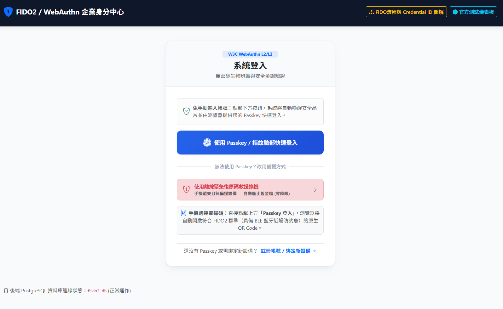
> **圖 1：系統登入首頁**  
> 提供「使用 Passkey / 指紋臉部快速登入」、NIST「離線緊急復原碼救援換機」入口，以及「手機跨裝置掃碼」與「註冊帳號 / 綁定新設備」導引。底部並即時監控後端 PostgreSQL 資料庫連線狀態。

---

### 第二章：底層架構原理與 W3C L3 協定深探 (Module 2)

本系統內建專屬的互動式技術架構與電文封包解析模組，將 FIDO 聯盟與 W3C 規範之核心運作原理進行可視化呈現。

#### 2.1 Credential ID 樞紐與延續原理 (cID Continuity)
在 FIDO2 架構中，私鑰被永久鎖定在使用者設備的安全晶片中，伺服器碰不到私鑰。登入時伺服器與晶片如何對接？關鍵就在於 **Credential ID**：

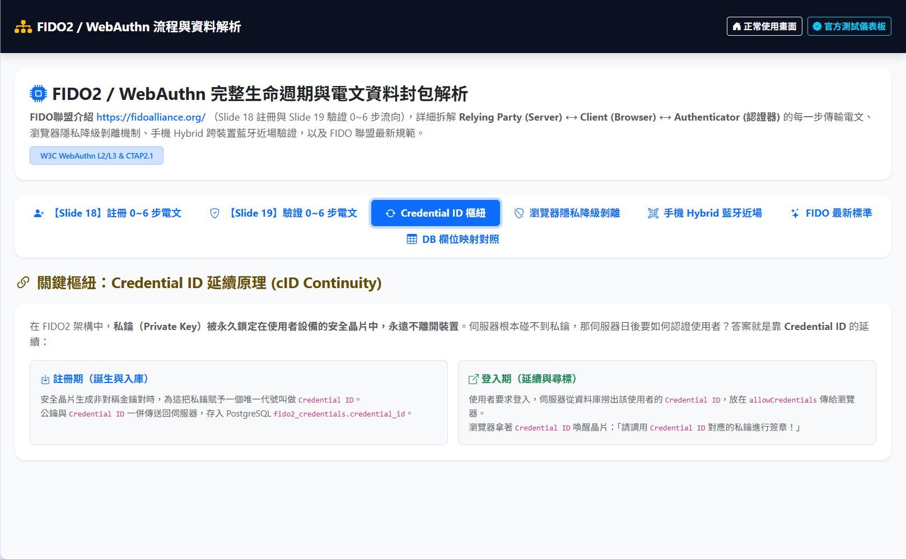
> **圖 2：Credential ID 延續原理**  
> - **註冊期（誕生與入庫）**：安全晶片生成非對稱金鑰對，為私鑰賦予全域唯一代號 `Credential ID`；公鑰與 `Credential ID` 一併傳回伺服器存入資料庫 `fido2_credentials`。  
> - **登入期（延續與尋標）**：使用者發起登入，伺服器從資料庫撈出該使用者的 `Credential ID` 放進 `allowCredentials` 參數傳給瀏覽器；瀏覽器拿著 `Credential ID` 喚醒對應的安全晶片進行私鑰簽章。

#### 2.2 手機掃碼跨裝置登入：FIDO Hybrid (caBLE) 與藍牙近場防釣魚
許多人誤以為跨裝置掃碼只是「手機連到網站按確認」，這在安全性上存在重大漏洞（易受遠端轉發 QR Code 釣魚）。FIDO 聯盟制定的 Hybrid 協定從物理層面解決此問題：

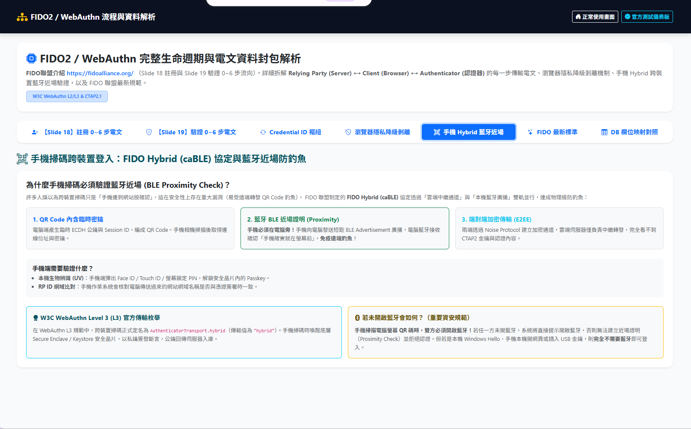
> **圖 3：FIDO Hybrid (caBLE) 協定與藍牙近場證明**  
> 1. **QR Code 內含臨時密鑰**：電腦端產生臨時 ECDH 公鑰與 Session ID 編入 QR Code，手機相機掃描取得連線資訊。  
> 2. **藍牙 BLE 近場證明（Proximity Check）**：手機必須在電腦螢幕旁向電腦發送短距 BLE 廣播，電腦藍牙接收確認「手機確實就在螢幕前」，**直接在物理層面免疫遠端釣魚**！  
> 3. **端對端加密傳輸（E2EE）**：兩端透過 Noise Protocol 建立加密通道，雲端轉發伺服器完全無法窺探 CTAP2 金鑰與認證內容。

#### 2.3 FIDO 聯盟最新標準與產業演進 (2025 ~ 2026)
系統全面支援並對齊國際最新產業趨勢：

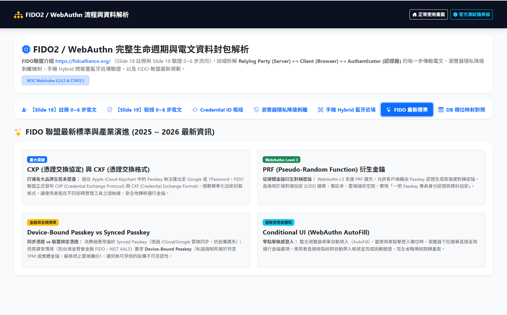
> **圖 4：FIDO 聯盟最新標準與產業演進**  
> - **CXP / CXF（憑證交換協定與格式）**：打破 Apple / Google / 1Password 密碼管理工具壁壘，實現通行金鑰的安全跨平台轉移。  
> - **WebAuthn L3 PRF（Pseudo-Random Function）**：硬體金鑰衍生對稱密鑰，支援客戶端 E2EE 檔案與雲端機密加密。  
> - **Device-Bound Passkey vs Synced Passkey**：滿足台灣金管會金融 FIDO 與 NIST AAL3 嚴格要求（私鑰強制死鎖於本機 TPM / 實體金鑰，嚴禁雲端備份）。  
> - **Conditional UI (WebAuthn AutoFill)**：整合瀏覽器原生表單自動填入，實現零點擊無感登入。

---

### 第三章：使用者註冊與多裝置 Passkey 綁定 (Module 3)

使用者初次使用或需要新增第二台備援設備（如備用手機、公司筆電或 YubiKey）時，系統提供安全平滑的註冊與綁定體驗。

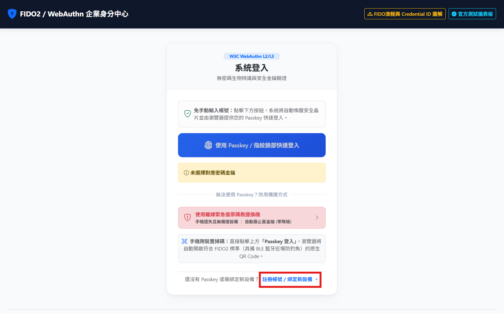
> **圖 5：首頁友善提示與註冊入口**  
> 當使用者尚未建立 Passkey 時，首頁提供明確的黃色指引，並引導點擊「註冊帳號 / 綁定新設備」。

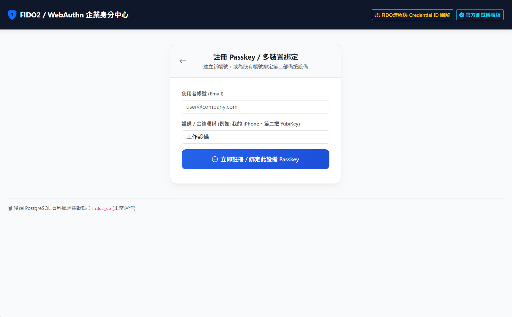
> **圖 6：註冊與多裝置綁定表單**  
> 支援輸入使用者帳號 Email 與自訂設備暱稱（如「工作設備」、「我的 iPhone」）。

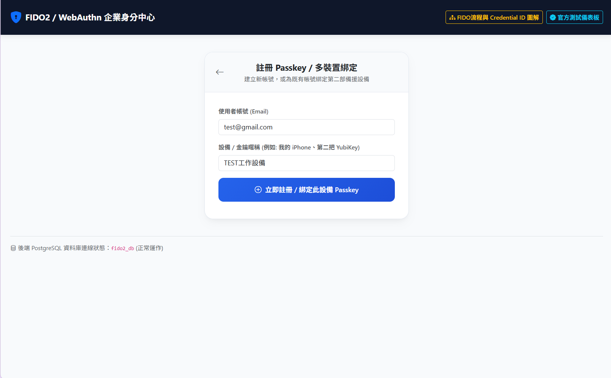
> **圖 7：輸入註冊示範資料**  
> 填入帳號 `test@gmail.com` 與設備暱稱 `TEST工作設備` 後，點擊「立即註冊 / 綁定此設備 Passkey」。

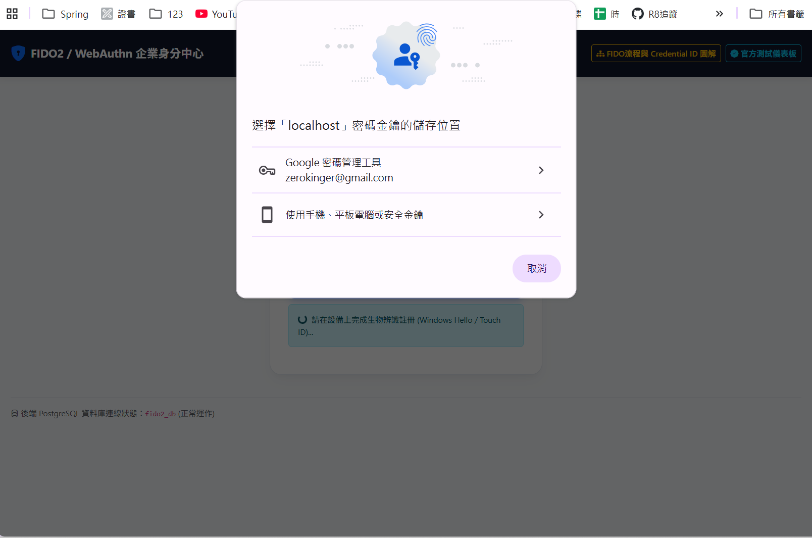
> **圖 8：瀏覽器原生安全對話框**  
> 系統調用標準 `navigator.credentials.create()`，觸發瀏覽器原生介面，可選擇「Google 密碼管理工具」或「使用手機、平板電腦或安全金鑰」。

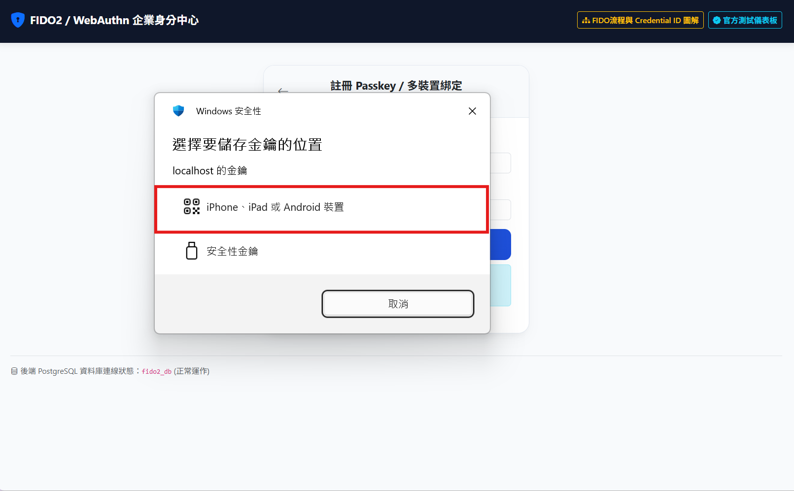
> **圖 9：作業系統安全性提示**  
> 使用者可選擇將 Passkey 儲存於 Windows Hello 本機生物辨識，亦可選擇外接安全金鑰或跨裝置手機。

---

### 第四章：NIST 零信任 8 組離線緊急災難備援碼 (Module 4)

企業推行無密碼最常遇到的痛點為「手機遺失、晶片損壞時該如何登入？」。本系統徹底捨棄不安全的客服重設或簡訊驗證，遵循 NIST 規範提供純離線緊急災難復原碼：

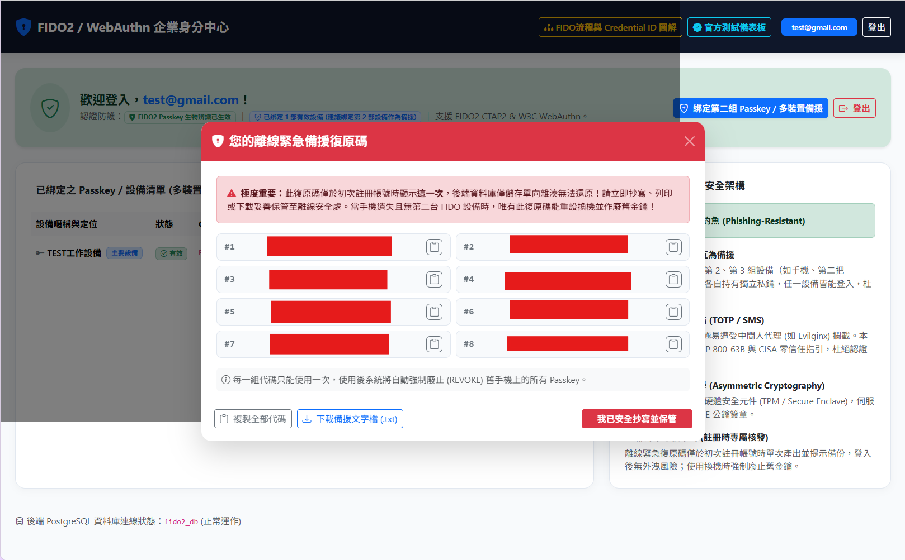
> **圖 10：初次註冊單次專屬核發之 8 組離線緊急復原碼**  
> - **不可逆防護**：後端 PostgreSQL 僅保存單向雜湊值，伺服器端永遠無法還原明文。  
> - **單次消耗與強制廢止**：每一組復原碼只能使用一次；**當手機遺失使用復原碼救急登入時，系統將自動強制廢止（REVOKE）舊設備的所有 Passkey 金鑰**，防堵拾獲遺失手機者進行未授權存取。  
> - **便利備份**：提供一鍵「複製全部代碼」與「下載備援文字檔 (.txt)」離線安全保存。

---

### 第五章：個人儀表板與金鑰生命週期管理 (Module 5)

註冊或登入完成後，使用者進入個人專屬管理儀表板，全面掌握帳號下的所有有效金鑰。

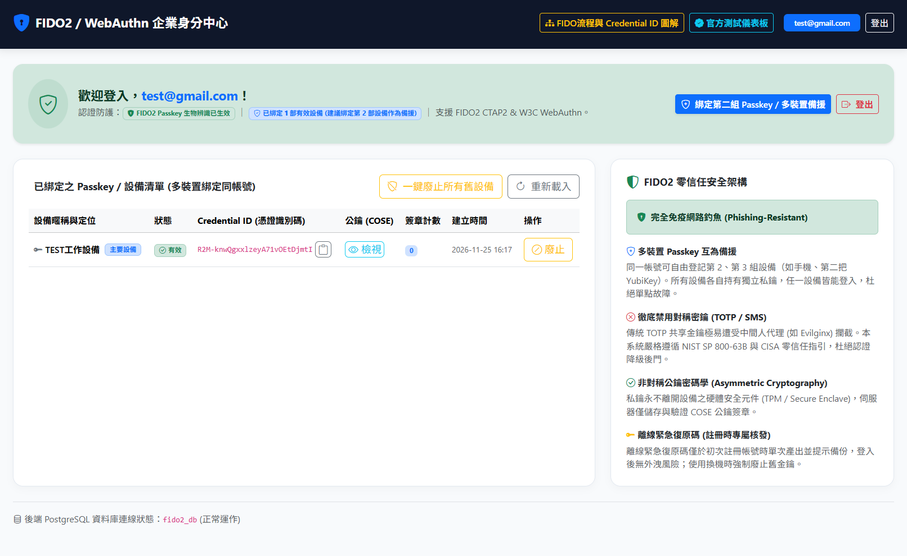
> **圖 11：已綁定之 Passkey / 設備清單**  
> - **設備清單**：清楚列出設備暱稱、定位標籤（主要設備、第 2 組備援等）、啟用狀態、Credential ID 與建立時間。  
> - **金鑰生命週期**：支援檢視 COSE 公鑰結構、查看當前簽章計數（Signature Count），並提供單鍵個別作廢與「一鍵廢止所有舊設備」功能。  
> - **右側零信任看板**：即時宣導免受釣魚攻擊、多裝置相互備援及非對稱密碼學原則。

---

### 第六章：無密碼快速登入與跨裝置驗證 (Module 6)

日常登入無需繁瑣步驟，使用者僅需點擊登入按鈕即可透過本機生物辨識（指紋/人臉）或掃描螢幕 QR Code 登入。

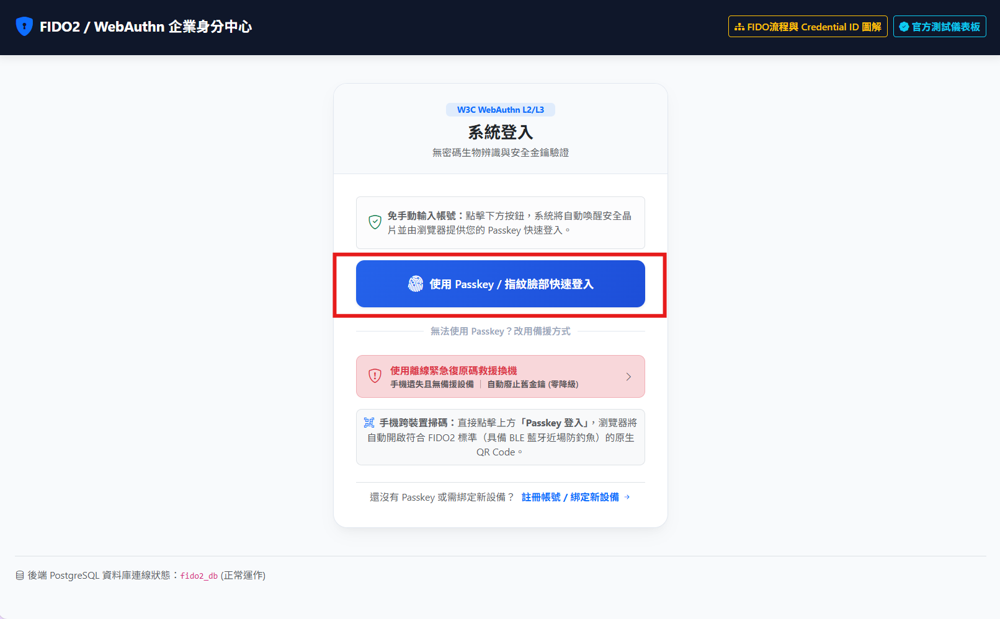
> **圖 12：首頁點擊快速登入**  
> 點擊「使用 Passkey / 指紋臉部快速登入」，系統即刻發起 WebAuthn Get Assertion 請求。

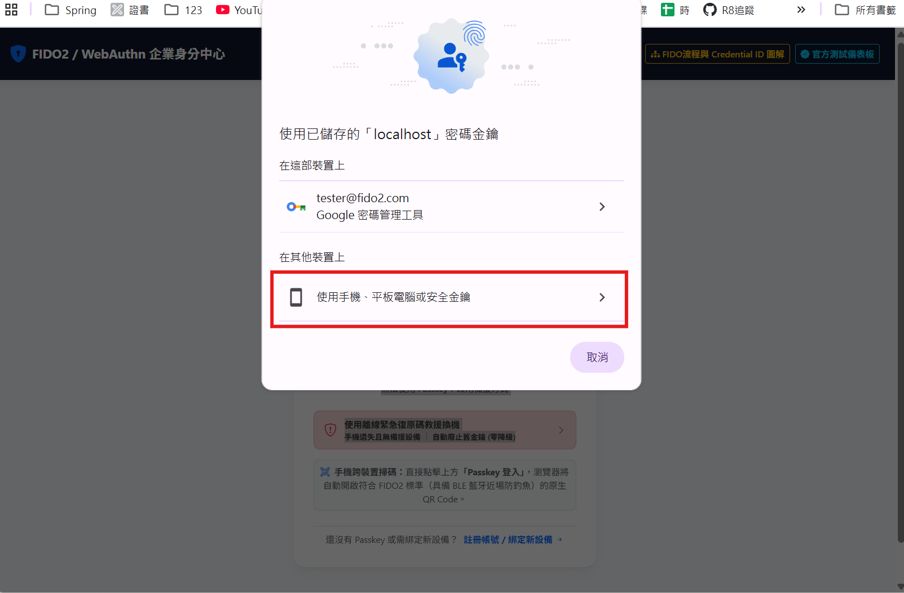
> **圖 13：選取通行金鑰**  
> 瀏覽器自動比對儲存之憑證，可直接點擊已存通行金鑰快速登入，或選擇「使用手機、平板電腦或安全金鑰」。

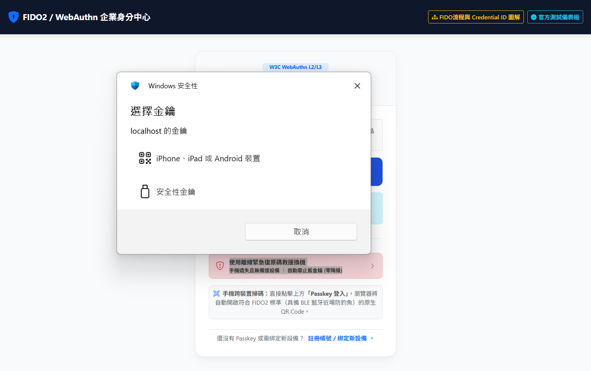
> **圖 14：安全性金鑰選取**  
> 呼叫本機硬體安全對話框進行生物辨識核驗。

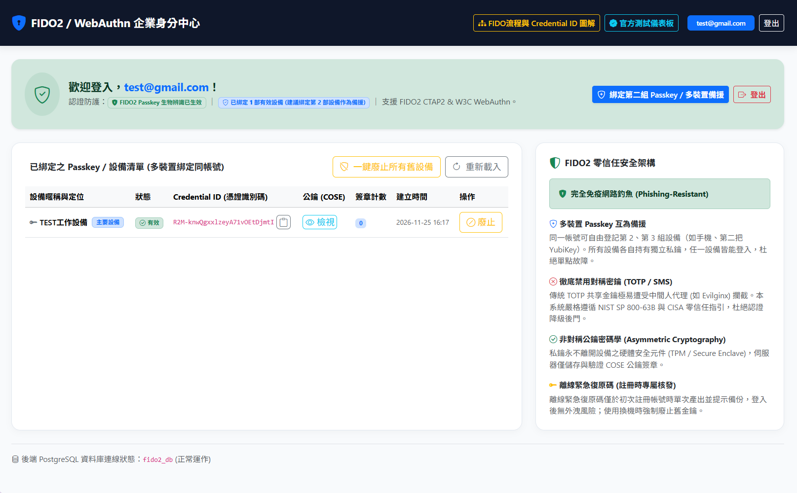
> **圖 15：生物辨識成功解鎖**  
> 毫秒級完成公鑰簽章核驗，成功登入進入個人安全儀表板。

---

### 第七章：最高管理員後台專屬控制台 (Module 7)

系統具備角色感知（Role-Based Access Control, RBAC）架構。當管理員身分（如 `tester@fido2.com`）通過生物辨識登入後，頂部導航列將自動解鎖管理權限。

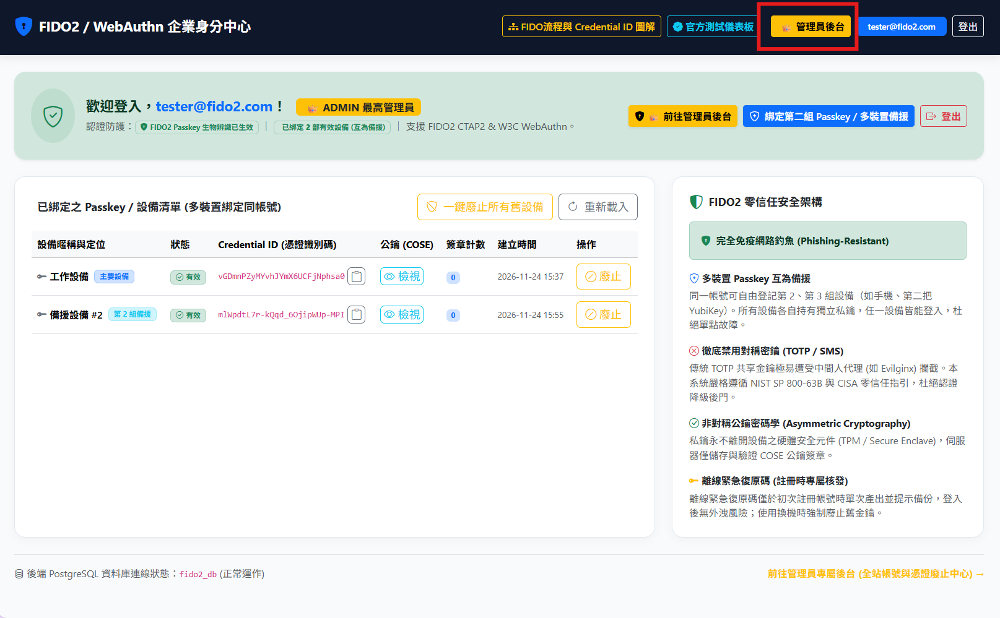
> **圖 16：最高管理員專屬身分標章與入口**  
> 登入者擁有 `ADMIN 最高管理員` 身份時，頂部與頁面中央自動浮現金色「管理員後台 (Admin Portal)」入口。

#### 7.1 後台頁籤一：全站帳號與 Passkey 憑證管理
提供企業資安長與管理員全盤掌握全公司帳號與通行金鑰狀況：

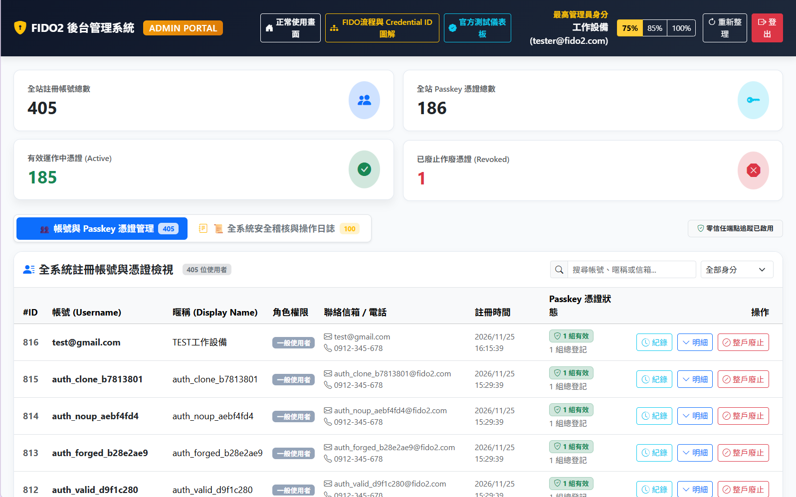
> **圖 17：全站帳號與 Passkey 憑證檢視頁籤**  
> - **全站數據看板**：即時統計全站註冊帳號總數（405 位）、全站 Passkey 憑證總數（186 組）、有效運作中（185 組）與已廢止（1 組）。  
> - **檢索與篩選**：支援關鍵字搜尋（帳號、暱稱、信箱）與角色權限過濾。  
> - **穿透式管理**：單一帳號可即時查看「紀錄」、展開憑證「明細」，並提供「整戶廢止」功能（一鍵終止特定離職員工或可疑帳號的所有金鑰）。

#### 7.2 後台頁籤二：全系統安全稽核與歷史操作軌跡 (Audit Log Timeline)
落實零信任「持續驗證、永不信任」之稽核要求：

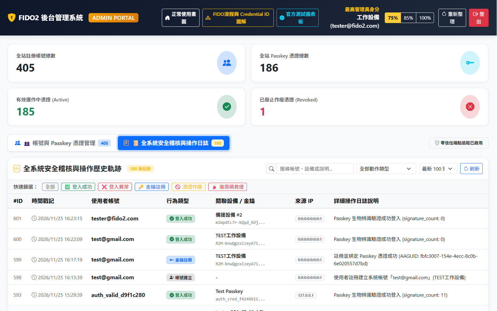
> **圖 18：全系統安全稽核與操作歷史軌跡頁籤**  
> - **零信任端點追蹤**：詳列時間戳記、帳號、行為類型（登入成功、金鑰註冊、帳號建立、憑證廢止等）、關聯設備暱稱與 Credential ID、來源 IP。  
> - **底層金鑰參數可視化**：在詳細日誌中精確記錄每一次驗證的 `signature_count` 數值（防範重放攻擊與複製金鑰），以及金鑰硬體辨識碼 `AAGUID`（如 `fbfc3007-154e-4ecc-8c0b-6e020557d7bd`）。

---

### 第八章：安全登出與會話防禦 (Module 8)

為防範終端公用電腦因點擊「上一頁」導致的敏感資訊外洩或會話劫持，系統配置高等級會話終止機制。

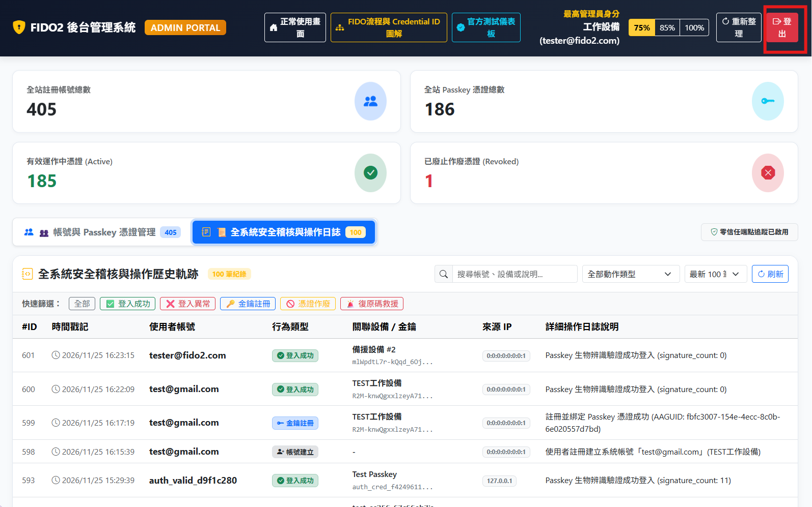
> **圖 19：點擊管理員後台登出**  
> 右上角紅框標註之登出按鈕，一鍵終止伺服器端 Session 與瀏覽器 Cookie。

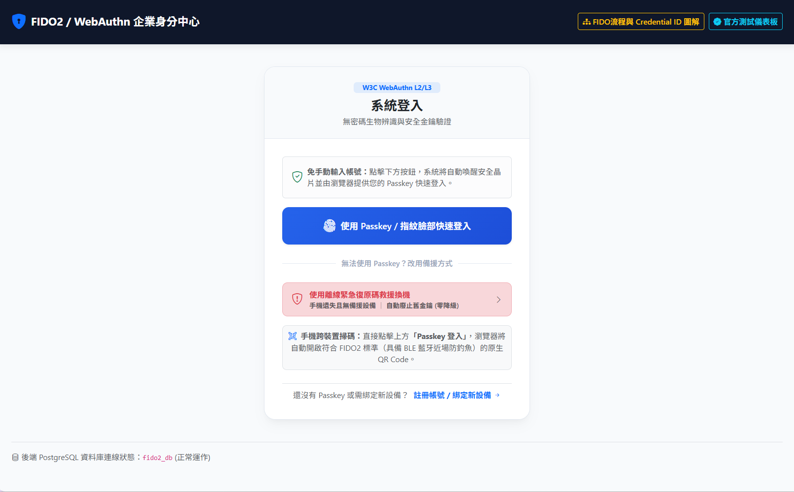
> **圖 20：安全登出回到系統首頁**  
> 整合 Anti-Bfcache（反前進後退快取）標頭，即使點擊上一頁亦無法重新進入後台，保障公用或共享工作站之會話安全。

---

## 🗄️ 資料庫架構與實體關聯 (Database Schema)

系統採用 **PostgreSQL** 關聯式資料庫，設計 8 大核心資料表並具備完整中文化欄位註釋：

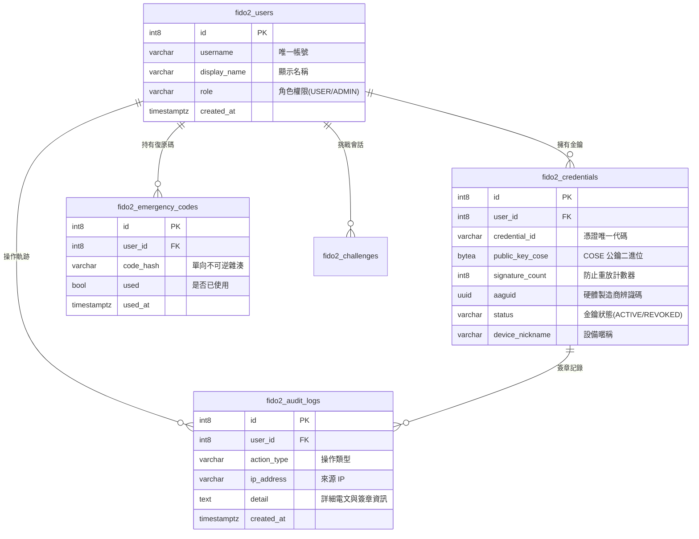

---

## 📁 儲存庫結構說明 (Repository Structure)

```
.
├── README.md              # 系統完整架構與圖文導覽說明文件 (本檔案)
├── FIDO說明文件.pdf        # 完整 25 頁 FIDO2 決策者與非技術人員導覽手冊
├── 1.png ~ 20.png         # 系統高解析度實機操作截圖 (共 20 張)
```

> [!TIP]
> 儲存庫內同時附帶完整的 **`FIDO說明文件.pdf`**，包含針對決策者、資安主管與非技術人員之深入架構分析與簡報說明，歡迎下載參閱。

---

## 🛠️ 技術棧總覽 (Technology Stack)

| 領域 | 使用技術 / 規範標準 | 說明 |
| :--- | :--- | :--- |
| **國際資安規範** | W3C WebAuthn Level 3 (WD) | 最新無密碼驗證規範（含 PRF, Hybrid 傳輸） |
| | FIDO2 CTAP 2.1 | 用戶端至認證器協定標準 |
| | NIST SP 800-63B AAL3 | 美國國家標準局最高身分保證等級 |
| **後端核心** | Java 17+ / Spring Boot 3.3.x | 高效能非同步微服務骨幹 |
| | WebAuthn4J | 符合 FIDO 規範之嚴格斷言驗證函式庫 |
| **資料庫** | PostgreSQL 15+ | 支援原生 UUID、BYTEA 二進位與 JSONB 稽核欄位 |
| **前端架構** | 現代響應式 HTML5 / Bootstrap 5 / JS | 封裝原生 WebAuthn API，支援跨瀏覽器自適應 |
| **合規測試** | 24/24 FIDO Official Conformance | 官方合規測試全數通過 |

---

## 📜 授權條款 (License)

本專案遵循 [MIT License](LICENSE) 條款開源發布。
