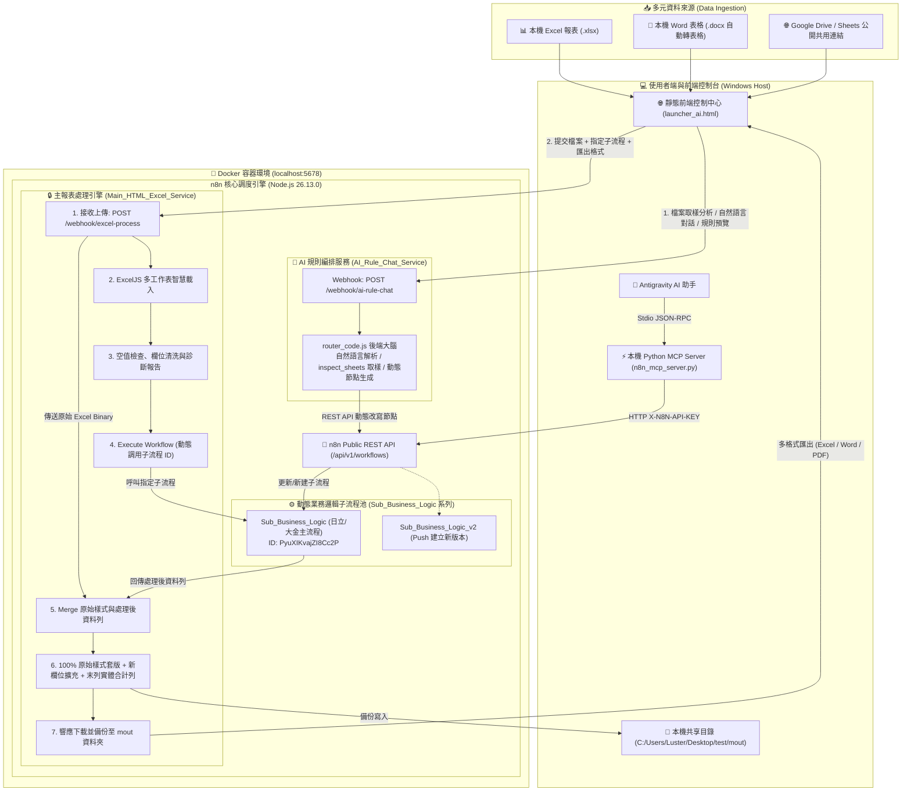

# 🏗️ Ivan 自動化報表處理中心 — 系統架構說明書

本文件說明 **「Ivan 自動化報表處理中心」** 的整體系統架構與技術設計。
本系統結合了 **靜態前端控制台 (HTML5)**、**多元檔案載入 (Excel / Word / Google Drive)**、**多格式匯出引擎 (Excel / Word / PDF)**、**AI 自然語言邏輯模擬 (前10筆+後5筆取樣與加總列)**、**n8n 主從解耦工作流 (Master-Sub)** 與 **`router_code.js` 核心排程服務**。

---

## 1. 整體架構全覽圖 (System Architecture)

---

## 2. 核心工作流三層架構職責表

本系統採用 **固定主服務 + 動態子流程 + 獨立 AI 排程引擎** 的三層解耦設計：

| 層級 | 工作流名稱 / 檔案 | ID / 檔案 | 職責與特性 |
| :--- | :--- | :--- | :--- |
| **🔒 主服務層 (固定防禦)** | `Main_HTML_Excel_Service` | `ontS5qESsLF3yObq` | 負責接收上傳檔案、解析多工作表、執行資料診斷、動態呼叫指定子流程，並以 ExcelJS 進行 **100% 原始樣式套版寫回**，支援動態擴充新欄位、末列實體合計列生成與備份。 |
| **⚙️ 業務邏輯層 (動態切換)** | `Sub_Business_Logic` (系列版本) | `PyuXIKvajZI8Cc2P` | 包含單純資料處理節點：**條件篩選、欄位計算、多欄位分組合併與加總、日期新欄位、Excel 排序、去重、前 N 筆限制**。各品牌/部門可有獨立子流程版本。 |
| **💬 AI 控制大腦 (邏輯驅動)** | `AI_Rule_Chat_Service` [router_code.js](file:///C:/Users/Luster/Desktop/bat/router_code.js) | `NsvIPoL6CBsE5byw` | 提供 `/webhook/ai-rule-chat`。負責對話意圖解析、工作表前 10 筆+後 5 筆取樣分析 (`inspect_sheets`)、模擬預覽條列說明生成，並透過 n8n REST API 即時熱更新子流程。 |

---

## 3. 前端控制台特色架構 (`launcher_ai.html`)

1. **三頁式現代向導流程 (Wizard Layout)**：
   * **第 1 頁：多元檔案載入**：
     * 本機 Excel (`.xlsx`)。
     * 本機 Word 報表 (`.docx`)：自動解析 Word 內嵌 XML 表格，無縫轉換為標準工作表結構。
     * Google Drive / Google Sheets：走公開共享 URL 透過 n8n 代理抓取，無跨域 CORS 阻擋，載入後自動清空 URL 避免重複加載，附帶一鍵「移除檔案」按鈕。
   * **第 2 頁：工作表（Sheet）篩選**：自動偵測多工作表名稱、行數、隱藏狀態，支援單選或多選勾選處理。
   * **第 3 頁：執行檢查與多格式匯出**：
     * 支援一鍵執行子流程並生成空值與缺欄診斷報告（不自動下載，確認報告後再下載）。
     * **多格式匯出支援**：可自由複選匯出 **Excel (.xlsx)**、**Word (.docx)**、**PDF 報表 (.pdf)**。
2. **AI 自然語言邏輯確認與視覺化模擬表格 (Simulation Engine)**：
   * **點擊欄位帶入**：點選模擬表格表頭，自動發光並將欄位名稱插入指令輸入框游標處。
   * **前 10 筆 ＋ 最末後 5 筆取樣展示**：中間清晰展示省略範圍列數提示，末尾 5 筆高亮真實實體行號。
   * **最下方整欄加總列**：預覽表格底部固定渲染 `∑ 加總列`，即時呈現數值加總效果。
3. **業務邏輯條列化 1. 2. 3. 與專屬檢視彈窗**：
   * 資料合併步驟分為：`1. 相同資料進行合併`、`2. 合併資料加總`、`3. 新增自訂欄位`、`4. 最末列整欄加總`。
   * 卡片內建 **「🔍 詳細邏輯」點開按鈕**（支援原地展開收合）與 **「🔍 彈窗完整檢視規則」** 760px 大視窗全覽。

---

## 4. 業務邏輯節點類型與 `router_code.js` 能力總覽

子流程節點均透過純淨的 Metadata 註解進行標記，方便前端雙向逆向解析：

| 節點類型 | 代表 Metadata | 支援功能與說明 |
| :--- | :--- | :--- |
| **條件篩選 (Filter)** | `n8n-nodes-base.filter` | 自動處理千分位逗號，支援數值或文字的大於、小於、等於、不等於、包含等過濾條件。 |
| **欄位計算 (Compute)** | `// META_TYPE: compute` | 支援加減乘除公式（如 `[單價(未稅)] * 1.05`）、時間函數 `NOW() 目前時間` 等，自動擴充新欄位。 |
| **多欄分組合併 (Group Merge)** | `// META_TYPE: multi_group_merge` | 支援依多個指定欄位（如 `廠牌+型號` 或 `銷售對象`）合併相同列；指定來源欄位加總並產出新欄位（如加總 `台數` 產出 `總數量`）；明細欄位保留換行合併。 |
| **自訂欄位擴充 (Extra Columns)** | `// META_EXTRA_COLS: [...]` | 在合併時同步擴充其他欄位，如 `修改日期 = NOW()`、`修改單位 = 大金` 等。 |
| **末列實體合計列 (Total Row)** | `// META_TOTAL_ROW: true` | 在匯出的實體 Excel 最底列真實新增一行「合計列」，主要欄位標註 `合計`，針對指定欄位（如 `總數量`）執行整欄加總計算。 |
| **Excel 排序 (Sort)** | `// META_TYPE: sort` | 支援單一欄位升冪（小到大）或降冪（大到小）智慧排序。 |
| **去除重複 (Dedupe)** | `// META_TYPE: dedupe` | 依指定單欄或多欄（如 `發票號碼`）移除後續重複資料列。 |
| **筆數限制 (Limit)** | `// META_TYPE: limit` | 僅保留前 N 筆處理後資料。 |
